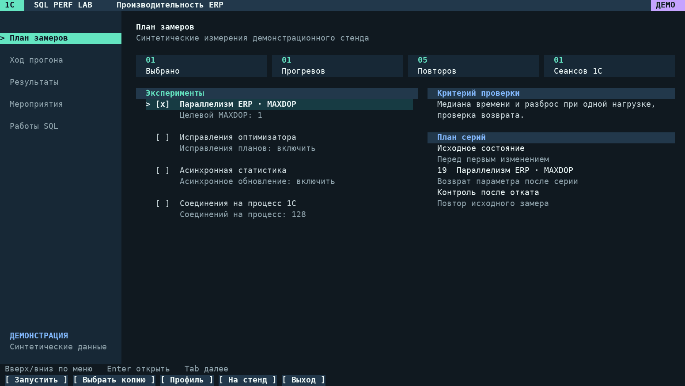

# 1C SQL Perf Lab

Терминальная лаборатория для замеров 1С и SQL Server на выделенном стенде. Выбираешь параметры, запускаешь одинаковую нагрузку и сравниваешь время каждой операции с исходным. В комплекте один Windows x64 EXE. Для демо достаточно распаковать архив и запустить программу.



## Запуск

1. Скачай `1c_sql_perf_lab-windows-x64.zip` из [Releases](../../releases). Распакуй в папку, где у тебя есть права на запись. Запусти `perf-lab.exe`.
2. Первый экран открывается в режиме **ДЕМО**. Нажми **Enter**, чтобы увидеть полный цикл на синтетических данных. **Пробел** включает или снимает пункт. **1–4** переключают план, ход прогона, результаты и каталог.
3. Для своего стенда нажми **e**. Введи адрес экземпляра, ожидаемое имя сервера, базу SQL и параметры нагрузки. **Enter** редактирует поле, **Ctrl+U** очищает, **Ctrl+S** сохраняет профиль рядом с программой. **l** выбирает стенд. Перед изменением экран покажет имя SQL и базу.
4. Во время прогона **Esc** отменяет нагрузку и запускает проверяемый возврат настроек. На экране итогов **↑/↓** переключают серии. **o** открывает HTML-отчёт, **h** возвращает последний сохранённый протокол.

## Что запускается

| Пункт каталога | Изменение на стенде |
|---|---|
| 19. MAXDOP | Изменяет параллелизм на уровне выбранной базы ERP. Значение экземпляра попадает в инвентаризацию. |
| 24. Исправления оптимизатора | Переключает QUERY_OPTIMIZER_HOTFIXES на проверенной сборке SQL. Укажи её полный номер в профиле после проверки обновления. |
| 25. Асинхронная статистика | Переключает AUTO_UPDATE_STATISTICS_ASYNC при включённой автоматической статистике. Для интерпретации нужен сценарий, который действительно вызывает пересчёт. |
| КЛ. Кластер 1С | Меняет лимит соединений на процесс **выбранного рабочего сервера** через rac, контролирует фактическое значение, повторяет нагрузку и возвращает лимит. Выбери конкурентную нагрузку и такую длительность, чтобы распределение процессов успело измениться. |

В каталоге 38 исходных мероприятий и отдельная карточка кластера. Исполняемые пункты помечены «эксперимент». Остальные карточки содержат критерий проверки. Программа уже собирает доступные исходные сведения о SQL, настройках базы, tempdb и копировании. Установка обновлений, перенос баз и остальные административные работы пока остаются за пределами автоматического прогона.

## Нагрузка 1С

Встроенный сценарий подключается к указанной информационной базе через 64-разрядный `V83.COMConnector` в Windows PowerShell и читает один существующий документ ERP по UUID. В профиле укажи имя объекта метаданных (например, `ЗаказКлиента`) и UUID документа из тестовой копии. Один и тот же документ используется во всех сериях. Измеряется вызов получения объекта. Время запуска PowerShell и установки соединения вынесено за пределы таймера. Чтение одного объекта подходит для проверки подключения и процедуры замера. Для оценки MAXDOP нужен сценарий с тяжёлым запросом. Для эксперимента с кластером нужен сценарий с длительно перекрывающимися сеансами.

SQL использует текущую учётную запись Windows. Для 1С доступна аутентификация ОС или переменные окружения `PERFLAB_ERP_USER` и `PERFLAB_ERP_PASSWORD`. В профиле укажи базу 1С, которая зарегистрирована именно на выбранной базе SQL. Для изменений нужны права на настройку тестовой базы, для кластера — рабочий доступ к RAS и подходящий к версии платформы `rac.exe`. Текущая реализация rac работает в контексте запуска без передачи пароля администратора кластера. Настройки кластера затрагивают рабочий сервер целиком. Используй отдельный кластер стенда.

**Свой сценарий или «Зонд производительности».** В `local/stand.json` поле `Workload` принимает массив из пути к исполняемой программе и её аргументов. Путь к локальному обработчику указывай абсолютный. Пустой массив выбирает встроенный сценарий. Программа вызывает обработчик без командной оболочки один раз на сеанс в каждом повторе. Обработчик выполняет конкретные операции в 1С и пишет в stdout один UTF-8 JSON, например `{"Проведение заказа":184.2,"Подбор":72.6}`, где значения — время в миллисекундах. Получает `PERFLAB_WORKER`, `PERFLAB_ERP_SERVER`, `PERFLAB_ERP_DATABASE` и `PERFLAB_SQL_DATABASE`. Ошибка операции должна вернуть ненулевой код выхода. Обработчик запуска «Зонда» зависит от установленной версии обработки и настраивается на площадке. Встроенный сценарий работает без «Зонда». Сценарий, меняющий документы, должен сам возвращать одни и те же исходные данные к следующему повтору.

## Как устроен эксперимент

- Инвентаризация считывает фактическую сборку, экземпляр, базу и текущее значение параметров. Системные базы исключены. Приложение берёт сеансовую блокировку экспериментов в выбранной базе.
- Каждая серия начинается с прогрева. Сначала измеряется исходное состояние. Затем каждый выбранный параметр по очереди меняется и возвращается. После каждого изменения и возврата значение считывается заново. Если фактическое значение уже совпадает с целью, пункт пропускается с записью причины.
- Для двух и более изменившихся параметров делается отдельная серия со всеми выбранными настройками вместе. Она показывает фактическое взаимодействие параметров, включая замедления. В конце повторяется контроль на исходных значениях. Для коротких операций увеличь число повторов и проверь, сопоставимы ли исходный и контрольный замеры.
- При нескольких сеансах один образец — среднее время одной операции по параллельно запущенным клиентам. Отчёт показывает медиану этих образцов, минимум, максимум, число повторов и изменение к исходной медиане. Изменение в процентах само по себе не доказывает эффект. Обновление планов, состояние кэшей и фоновая работа могут повлиять на результат.
- В JSON сохраняются образцы, журнал и доступные счётчики I/O по файлам до и после серии. При настроенном RAS добавляются число рабочих процессов и сводные счётчики кластера в момент снимка. Недостающие права на телеметрию отмечаются в протоколе.
- Перед каждой записью программа сохраняет локальный журнал с исходным значением. После аварийного закрытия запусти тот же экземпляр из той же папки, выбери стенд и нажми **r**. Повторный прогон с незавершённым журналом блокируется. Если настройку уже изменили вручную на третье значение, программа покажет конфликт.

## Файлы и консоль

Профиль хранится в `local/stand.json`, отчёты — в `runs/<прогон>/report.html` и `report.json`. Эти каталоги исключены из Git. В поставке нет имён и данных реальных площадок.

```powershell
.\perf-lab.exe
.\perf-lab.exe -demo -items 19,24,25,39
.\perf-lab.exe -init
.\perf-lab.exe -run -items=
.\perf-lab.exe -run -items 19
.\perf-lab.exe -recover
```

Для исходного замера без экспериментов в Windows PowerShell 5.1 используй `-items=` (пустой аргумент). Ключ `-home` задаёт папку с профилем и результатами. По умолчанию используется папка EXE.

Сборка из исходников — Go 1.24 или новее, `go test ./...`, затем `go build -trimpath -o perf-lab.exe .`. Интерфейс использует Bubble Tea и Lip Gloss. Проверки GitHub Actions включают тесты в Windows и Linux и отдельный тест изменения и отката настроек на временном SQL Server. Деморежим и тест SQL не воспроизводят реальный прогон ERP.

Документация по участвующим настройкам — [параметры базы SQL](https://learn.microsoft.com/sql/t-sql/statements/alter-database-scoped-configuration-transact-sql), [статистика](https://learn.microsoft.com/sql/relational-databases/statistics/statistics), [администрирование кластера 1С](https://1c-dn.com/library/tutorials/1c_enterprise_administrator_guide_client_server_mode_8_3_27/).
